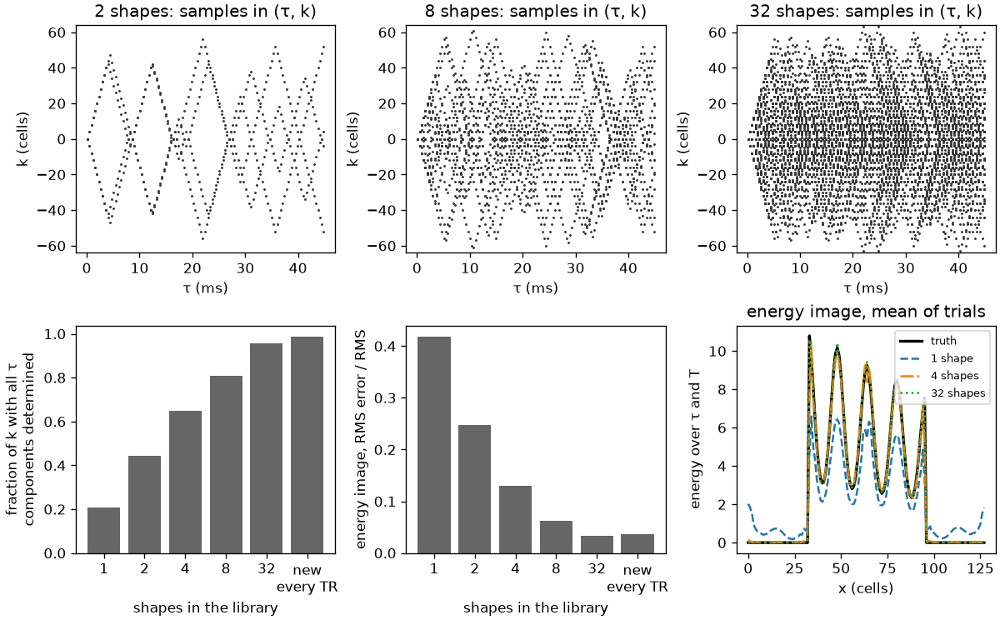
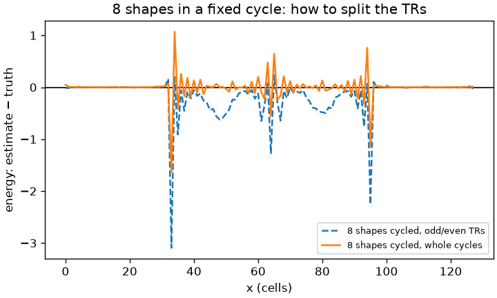

# Collapsing dimensions with quadratic norms

Status: analysis, with a 1D toy that checks its main claims (section 10, [`toy_x_t.py`](quadratic-norm-report/toy_x_t.py)). Nothing is implemented in the reconstruction. Started 2026-10-16. Application 3 (lagged correlation) is preliminary and needs refinement (section 6).

## Question

The data have three dimensions of space, the time since excitation τ within each TR, and the scan time $T$ ([coverage-target.md](coverage-target.md), section 1). A requirement can leave a dimension out of its output. So far that has meant an average: the static image averages over τ and $T$, which is linear, so it is one linear reconstruction. But often what is wanted from a dimension is not its mean but its size, measured by a 2-norm, with no interest in the detail along it. Three applications motivate this report:

1. **A magnitude-like image** at each voxel: the 2-norm over the continuous τ dimension, the continuous version of the root-mean-square combination of multi-echo data, collapsed over $T$ either as the total power acquired over the scan or as the energy of the mean over the scan (the DC term). It has no noise floor and none of the cancellation of an average over τ.
2. **The power of the fluctuations over $T$ in a band**, at each voxel: the power of the BOLD fluctuations, the quantity behind ALFF, without their time courses.
3. **Correlations across space and $T$**: the cross-covariance between voxels at a lag, for lagged models of connectivity. This one needs further refinement.

The usual route to any of these is a model of the dimension (for $T$, a low-rank or subspace model), a reconstruction of the detail along it, and then the norm. That route imposes the model's structure on the result: for a low-rank model, shared time courses ([b0-scan-time-plan.md](b0-scan-time-plan.md), section 3). Can a dimension be collapsed with a norm instead, without a model of it? For which norms does the reconstruction separate and become simpler, and what does it cost?

## Short answer

Yes, for quadratic forms: $q(r) = \mathbf{x}(r)^H W\, \mathbf{x}(r)$ over τ and $T$ with $W$ positive semi-definite, and its cross form $\mathbf{x}(r)^H W\, \mathbf{x}(r')$ between two voxels. All three applications are such forms.

- **The reconstruction separates** (section 2). In the eigenbasis of $W$, $q$ is a weighted sum of squared components (Parseval). Each component is a static reconstruction of the data weighted by its basis function; when the sampling does not depend on $T$, all of them share one normal operator and are solved as a batch. In $T$ the basis is the Slepian sequences of multitaper spectral estimation; in τ it is the τ basis that the relaxation 4D image already uses.
- **Errors that cancel in an average add up in a norm** (section 3). The aliasing and noise of each estimate put a positive bias on its square. **Products of estimates with independent errors remove it:** reconstruct the components from $K$ disjoint sets of TRs, whose sampling patterns and noise are independent, and keep only the products between different sets. $K = 2$, with the halves interleaved in time (odd and even TRs) so that both span the scan, is the split-half of the difference method for SNR and of cross-spectra in cosmology, and it is the practical form; $K = N$, one TR per set, is a U-statistic. The assumption is that the signal is smooth in $T$ (band-limited, set by physiology), not that it has low rank. The number of samples in one TR sets the variance, not what can be estimated.
- **Components that are large and outside the target must be subtracted first** (section 3.4), or their aliasing and its variance swamp a small target. What counts as outside depends on the application: for the magnitude-like image (application 1) the signal itself *is* the target; for the fluctuation power (application 2) it must be subtracted, resolved in τ, since its decay within each readout repeats in every TR at different k.
- **Application 1** (section 4): two options. The total power over τ and $T$ is invariant to any phase that changes over τ or $T$, like root-sum-of-squares over echoes and repetitions; the DC term, the 2-norm over τ of the τ-resolved static image, loses what a phase drift over $T$ cancels. Which is more useful is empirical, with the total power the likely default. Both come without a noise floor from products between independent sets of TRs; in the toy, unbiased to 1–2%, and under a phase drift of half a cycle the DC term keeps 0.41 of the energy and the total power 0.97.
- **Application 2** (section 5): a band of about 45 Slepian components for the BOLD band in 250 s, from the residual after the static image and the large out-of-band components (drift, respiration, the field modes). With a τ basis of two functions (the $S_0$ and R2\* directions), the same forms separate BOLD from non-BOLD power at each voxel, as multi-echo ICA does by the TE-dependence of components. Practical at 2–4 mm from the leakage alone; 1 mm needs the coils and spatial averaging.
- **Application 3** (section 6): the cross-spectrum between voxels from the same components, with the products within one TR left out, which removes the zero-lag correlation that one TR's aliasing puts between voxels. In the toy, a 0.6 s lag is recovered. What model of lag, which pairs, and how to handle the large sampling error of lag estimates and the vascular confounds are open.
- **Each TR is a 45 ms band in time, not an instant** (section 3.6): the basis is evaluated at each sample's time, and a change of the object during the readout is read as a term linear in τ.
- **The schedule decides where the leakage goes.** Independent rotations make it white over temporal frequency. A periodic schedule puts it at harmonics of its period, as UNFOLD does on purpose. The k–T spectral score of [example-requirements-design.md](example-requirements-design.md) (section 2) is exactly this leakage, so it is the right design objective for applications 2 and 3.

## 1. Data, timing, and quadratic forms

**Data.** TR $p = 1, \dots, N$ acquires $y_p = A_p\, x_p + n_p$, with $A_p$ the encoding of that TR (its samples, the coil maps, the NUFFT, the field map) and $x_p$ the image during it. Each $A_p$ samples far less than the image needs: one TR has 14 000 samples, the 1 mm ball 8.8 million cells.

**A TR is not an instant.** Sample $m$ of TR $p$ is at τ $= \tau_m$ and at absolute time $t_m = T_p + \tau_m$: the readout spreads each TR over about 45 ms of the 50 ms TR. In the plane of τ and absolute time, each TR is a diagonal segment $t - \tau = T_p$; in k and $t$, it is a stroke along which k changes quickly. The signal depends on both: on τ through relaxation (with the static field map estimated and corrected, as in any reconstruction), on $t$ through physiology. Sections 2–3.5 first treat $x_p$ as constant in $t$ over one readout, with its τ-dependence kept; section 3.6 removes that approximation.

**Targets.** A quadratic form at each voxel over the samples' coordinates (τ, $T$),

$$q_W(r) = \mathbf{x}(r)^H W\, \mathbf{x}(r), \qquad W \succeq 0,$$

with $\mathbf{x}(r)$ the signal of voxel $r$ as a function of τ and $T$, or its cross form $\mathbf{x}(r)^H W\, \mathbf{x}(r')$. The applications:

| application | $W$ | related use |
|---|---|---|
| 1. magnitude-like image | the identity on τ and $T$ (total power), or the identity on τ times the projector onto the mean over $T$ (DC term) | root-mean-square combination of echoes (van der Kouwe et al., 2008; Helms and Dechent, 2009) |
| 2. fluctuation power in a band | the projector onto the band in $T$, after the static image is subtracted; a weighting or a basis in τ | ALFF and fALFF (Zang et al., 2007; Zou et al., 2008); multi-echo combination for BOLD (Posse et al., 1999; Poser et al., 2006) |
| 3. lagged cross-covariance between voxels | the band projector shifted by a lag | coherence (Sun et al., 2004, 2005); lag structure (Mitra et al., 2014, 2015) |

Other modalities already image such quantities instead of the detail: functional ultrasound maps the power of the blood signal over slow time in each pixel (Macé et al., 2011), and SOFI maps temporal cumulants of fluorescence fluctuations (Dertinger et al., 2009). There every frame is fully sampled; here no TR is.

**It is linear in the lifted variable.** $q_W(r) = \operatorname{tr}(W\, \mathbf{x}(r)\, \mathbf{x}(r)^H)$, a linear functional of $\mathbf{x}\mathbf{x}^H$. Estimating linear functionals of a second-moment matrix from compressed linear measurements is the problem of compressive covariance sensing (Romero et al., 2016; Ariananda and Leus, 2012) and of covariance estimation from quadratic samples (Chen, Chi and Goldsmith, 2015); lifting quadratic measurements to a linear problem in $\mathbf{x}\mathbf{x}^H$ is also the idea of PhaseLift (Candès et al., 2013). The MRI case is easier: the encoding of each TR is known and differs between TRs, and the target is a few functionals per voxel, not the whole matrix.

## 2. Separation in the eigenbasis of $W$

Write $W = \sum_j \lambda_j\, \psi_j \psi_j^H$ with orthonormal $\psi_j$. Then

$$q_W(r) = \sum_j \lambda_j\, |c_j(r)|^2, \qquad c_j(r) = \langle \psi_j, \mathbf{x}(r) \rangle .$$

**Each component is a static reconstruction with weighted data.** A joint least-squares fit of the $c_j$ has a normal operator with blocks $\sum_m \psi_j(m)^*\, \psi_{j'}(m)\, a_m d_m a_m^H$ over the samples $m$, with $a_m$ the encoding row and $d_m$ the density weight. If the sampling pattern of each TR is drawn independently of $T$ (random rotations, the shuffled schedule), a basis over $T$ is uncorrelated with the patterns, the blocks are $\delta_{jj'}\, \bar A / N$ plus a fluctuation, and

$$\hat c_j = N \bar A^{-1} \sum_m \psi_j(m)^*\, a_m\, d_m\, y_m ,$$

a static reconstruction (the operator $\bar A$ that `relaxed-rosettes sense` inverts now) of the data weighted by $\psi_j$. All components share one normal operator, so one set of Toeplitz kernels (Fessler et al., 2005) and one preconditioner, and they are solved together as a batch of right-hand sides (block CG; O'Leary, 1980). The fluctuation that this drops is the leakage of section 3.1.

**In $T$, the basis for a band is the Slepian sequences.** The eigenvectors of the band projector restricted to $N$ samples are the discrete prolate spheroidal sequences (Slepian, 1978); about $2 B\, N T_R$ of them have eigenvalues near 1, for a band of width $B$ (both signs of frequency). $\sum_j |\hat c_j|^2$ is then the multitaper estimate of the band power (Thomson, 1982; Percival and Walden, 1993), computed from the k-space data instead of from time courses. Every quadratic spectrum estimator is of this form, with its eigenvectors as the tapers (Mullis and Scharf, 1991). At the defaults (TR 50 ms, 5000 TRs, 250 s), the BOLD band 0.01–0.1 Hz has $J \approx 2 \times 0.09 \times 250 = 45$ components.

**In τ, the basis is the τ basis of the relaxation 4D image.** Every TR reads out on the same ADC grid in τ, but each shape is at its own $|k|$ at each τ: by design the shapes sample different sets in $(|k|, \tau)$, and the rotation of a TR changes only the direction of k. So the $(|k|, \tau)$ pattern of a TR is that of its shape, drawn from the library by the schedule, and it differs from TR to TR. One shape cannot decouple the τ components, since its $|k|$ is a fixed function of τ; the library can. The components decouple when the distribution of $(|k|, \tau)$ pooled over the library, weighted by how often the schedule uses each shape, is separable: the distribution of $|k|$ is the same at every τ, the no-correlation condition of [example-requirements-design.md](example-requirements-design.md) (section 2). How well they are determined is set by the library's coverage of $(|k|, \tau)$ (the relaxation 4D requirement, and experiment 3 there), not by one TR; the toy with a finite library shows it (section 10, table 7 and figure 1). And because the shape and rotation are drawn independently for each TR, the per-TR errors of the τ components are independent across TRs, so the products of section 3.3 apply to forms over τ as well, wherever the signal changes slowly in $T$. Where it fails, the $L$ components are solved together, with $L \times L$ blocks of the same operator; for $L$ = 2–4 that is still cheap. For a form over τ and $T$ together, the basis is the product $\phi_l(\tau)\, \psi_j(T)$.

**The basis is set by the question, not fitted.** No rank is chosen from the data, and no structure in $T$ is imposed.

## 3. Bias, and how to remove it without a model

The estimate of each component is unbiased over the random patterns, but noisy and aliased. In an average over $T$ that error cancels; in a squared norm it does not.

### 3.1 Leakage: aliasing over temporal frequency

Let $z_p = R_p\, y_p$ be the estimate from TR $p$ alone, with $R_p = N \bar A^{-1} A_p^H D$, so $R_p A_p = I + \Delta_p$ and $\mathbb E\, \Delta_p \approx 0$. The error of a component in $T$ is $e_j = \sum_p \psi_j(p)^*\, \Delta_p\, x_p$. With the $\Delta_p$ independent across TRs,

$$\mathbb E\, |e_j(r)|^2 = \sum_p |\psi_j(p)|^2\; \mathbb E\, |(\Delta_p\, x_p)(r)|^2 .$$

For a Fourier or Slepian basis $|\psi_j(p)|^2 \approx 1/N$, so every component gets the same share: the average aliasing energy of one TR, divided by $N$. **Independent patterns make the aliasing white over temporal frequency.** A band of $J$ components gets $J/N$ of it. This is the temporal side of the incoherence argument of compressed sensing (Lustig et al., 2007). For random, uniform sampling of $S$ of $M$ cells, the aliasing energy of one TR is $\rho\, \lVert x_p \rVert^2$ with $\rho = M/S - 1$, spread evenly over space; the toy confirms the predicted bias (section 10, table 1).

**Deterministic schedules move the leakage instead of whitening it.** If the patterns repeat with a period of $m$ TRs, the leakage lands on the harmonics of $1/(m T_R)$ (table 3). UNFOLD (Madore et al., 1999) uses exactly this: it shifts the aliasing to the edge of the temporal spectrum and filters it out; k-t BLAST and k-t SENSE (Tsao et al., 2003) generalize it to lattice patterns in k–t. For a band, a periodic schedule whose harmonics avoid it has no leakage in it; one whose harmonic falls in it concentrates the leakage there. This is the risk that experiment 7 of [example-requirements-design.md](example-requirements-design.md) names for the roles of the shapes.

### 3.2 Noise

$\mathbb E\, |\hat c_j|^2$ also includes the noise energy of the component. It is the noise bias of any squared magnitude, as in root-sum-of-squares coil combination (Roemer et al., 1990; Constantinides et al., 1997) and the Rician bias of magnitude images (Gudbjartsson and Patz, 1995). It can be computed from the noise covariance (Kellman and McVeigh, 2005), for example with pseudo-replicas (Robson et al., 2008) or a stochastic trace estimate (Hutchinson, 1990), and subtracted. Section 3.3 removes it without that.

### 3.3 Products of estimates with independent errors

Split the TRs into $K$ disjoint sets (interleaved or random), reconstruct each component from each set, $\hat c_j^{(k)}$, and keep only the products between different sets:

$$\hat q = \frac{1}{K(K-1)} \sum_j \lambda_j \sum_{k \ne k'} \hat c_j^{(k)*}\, \hat c_j^{(k')} \qquad (\times K^2 \text{ for the sum over all TRs}).$$

The sets have independent sampling patterns and independent noise, so the errors of $\hat c^{(k)}$ and $\hat c^{(k')}$ are independent and $\mathbb E[\hat c^{(k)*}\, \hat c^{(k')}] = c^{*}\, c$: **no noise bias and no leakage bias**, whatever reconstruction each set uses (gridding, CG, regularized), provided it is applied to that set alone. **Interleave the sets in time** (odd and even TRs for $K = 2$): then every set spans the whole scan, and each estimates every component over $T$ whose frequency is well below its own Nyquist frequency, $1/(2 K T_R)$ (5 Hz for $K = 2$): the static image, a drift, a band, the cardiac cycle. A split into the first and second half of the scan would instead estimate different things in each half. **Each set must also hold the whole library of shapes.** The τ components are determined by the library's coverage of $(|k|, \tau)$ (section 2), so a set that holds only some of the shapes does not determine them. With the shapes in random order, interleaving by TR is enough. With the shapes cycled (the $m$ roles of [example-requirements-design.md](example-requirements-design.md), section 6.1), an odd and even split with $m$ even gives each half only half of the roles; split by whole cycles, or at random within each cycle, instead (section 10, figure 2). The choice of $K$:

- **$K = 2$ (split-half).** Each half is a full reconstruction, so each estimate is as good as the data allow, and the product has no bias. It is the difference method for measuring SNR (Reeder et al., 2005; Dietrich et al., 2007) and the cross-spectrum between independent detectors or data splits in cosmology (Hinshaw et al., 2003; Polenta et al., 2005; Tristram et al., 2005). With interleaved halves, this covers every component of the three applications, the slow components over $T$ included: each half has half the TRs, so its leakage is doubled, but the product is unbiased. In the toy, interleaved halves give the same DC term and total power as the per-TR products (table 5). It needs only two reconstructions of each component, not one per TR.
- **$K = N$ (one TR per set).** The per-TR estimates $z_p$ are cheap (gridding of one TR and a fixed filter), and leaving out each TR's product with itself is the construction of a U-statistic (Hoeffding, 1948): $\hat q_U = \hat q_W - \sum_p w(p,p)\, |z_p|^2$, which for a band is $\hat q_W - (J/N) \sum_p |z_p|^2$. It is the limit of the construction, and the one used for most of the toy, since its per-TR estimates are cheapest to compute there. In 3D, per-TR images cost a reconstruction (or at least an adjoint NUFFT onto the full grid) for each of 5000 TRs, so the interleaved split-half is the practical form; the U-statistic remains the clearest way to write the bias, and section 3.5's argument about coherence time is the same for both. The per-TR estimates must not share an operator that depends on all TRs in a way that couples their errors; a fixed density-compensated adjoint, or $\bar A^{-1}$ treated as fixed, satisfies that, while an exact static solve does not (its aliasing cancels in the sum, so the per-TR errors are dependent).

The same construction is how DICS estimates source power and coherence in a band from the cross-spectral density of MEG data, without time courses (Gross et al., 2001). In MRI, activation statistics have been written directly in terms of k-space data (Rowe et al., 2009), but for fully sampled frames. We have not found a precedent for estimating power, energy or coherence maps from undersampled k-space by products between independently sampled sets of TRs.

**What remains** is the part of the form within one set. For the U-statistic, $\mathbb E\, \hat q_U = q_W - \sum_p w(p,p)\, |x_p|^2$: for a band, $J/N$ times the energy of the signal at that voxel. When all of that signal is in the band, the term is exactly $(J/N)\, q_W$ and $\hat q_U / (1 - J/N)$ is unbiased (table 1: the bias is $-J/N$ = −1.75%). When a large component outside the band shares the voxel, the term includes it (table 2), which is one reason for section 3.4.

### 3.4 Large components outside the target

Products of independent estimates remove the bias of a component's own error, but not the variance that every other component's aliasing adds, nor (for the U-statistic) the within-set term of section 3.3, which grows with the total energy at the voxel. A component that is large and is not part of the target must therefore be subtracted from the data, $y - A\, \hat x_{\text{large}}$, before the target is estimated. Which components those are depends on the application:

- **Application 1 (magnitude-like image):** the signal itself is the target. Nothing is subtracted.
- **Application 2 (fluctuation power):** the static image is about 100 times the BOLD fluctuation. Without the subtraction, the band power estimate is 260 times the truth in the toy (table 2). The static image must be resolved in τ: within each readout the signal decays (by 60% over 45 ms at R2\* = 20/s), and that decay is the same in every TR but lands at different k in each, so after a τ-averaged subtraction it remains in every TR's residual and aliases into every temporal frequency. In the toy with readout timing, the τ-averaged subtraction leaves a band power 11 times the truth; a static model resolved in τ brings it within 3% (table 4). In 3D that model is the relaxation 4D image (the static image with a rank-$L$ τ basis; [example-requirements-design.md](example-requirements-design.md), section 3.1). Large components out of the band should be subtracted too: drift, the respiratory change of the object, and the field modes of [b0-scan-time-plan.md](b0-scan-time-plan.md). This is what the SVD clutter filter of functional ultrasound does before power Doppler (Demené et al., 2015).
- **Application 3 (lagged correlation):** as for application 2.

$\hat x_{\text{large}}$ comes from all TRs and is determined far better than the target, so subtracting it adds little error.

### 3.5 Coherence time, and products within one TR

Leaving out the products within one TR is free for a narrow band, where they are the fraction $J/N$ of the form. For the energy over $T$ ($W = I$) they would be everything. But a product of two estimates measures $|x|^2$ whenever both see the same $x$: within the coherence time of $x$ in $T$, about $1/B_{max}$ if its spectrum ends at $B_{max}$. Physiology changes slowly against a 50 ms TR (the BOLD band ends near 0.1 Hz, respiration near 0.5 Hz, the cardiac harmonics near 3 Hz), so the energy of a band-limited signal is its power in $[-B_{max}, B_{max}]$, a band form with $J/N = 2 B_{max} T_R$ (0.3 for 3 Hz). Pairs of different TRs within the coherence time do the work, and the samples within one TR, which are also within it, are left out only because they share one pattern. The assumption is smoothness in $T$, set by physiology, not a rank fitted to the data.

**Content above $B_{max}$**, or a form over τ within one TR without the help of other TRs, needs the products within one TR, whose aliasing is correlated. Their bias is still known from the trajectory:

- **Deconvolution.** Under random rotations, the per-TR energy is the true energy convolved with the mean squared point-spread function of one TR, plus the noise floor: $\mathbb E \sum_p |z_p|^2 = K_{\text{PSF}} \circledast \sum_p |x_p|^2 + \text{noise}$, with $K_{\text{PSF}} = \mathbb E\, |\mathrm{PSF}_p|^2$. Speckle interferometry recovers diffraction-limited power spectra from short exposures through random atmospheric phase by the same averaging of squared transforms (Labeyrie, 1970); the pseudo-$C_\ell$ estimators of CMB power spectra deconvolve the coupling kernel of an incomplete sky the same way (Hivon et al., 2002).
- **Pairs of samples in one TR.** In k-space, the energy needs, for each separation $q$, products $X(k)\, X(k - q)^*$ of samples of the same TR. Weighting each pair by the inverse of its probability under the random rotation gives an unbiased estimate (Horvitz and Thompson, 1952); leaving out each sample's product with itself removes the noise bias. What it needs is the set of differences one TR's samples cover, as nested and co-prime arrays estimate second-order statistics at more lags than they have sensors (Pal and Vaidyanathan, 2010; Vaidyanathan and Pal, 2011).

The conditioning is set by those differences, not by the number of samples: the Fourier transform of $K_{\text{PSF}}$ is the autocorrelation of one TR's sampling, averaged over the rotations. For uniform random sampling $K_{\text{PSF}}$ is a unit peak plus a flat plateau $\rho / M$ (table 1, last column), whose transform is 1 at every $q \neq 0$: perfectly conditioned at any $\rho$. A rosette TR has about 40 passes through the centre in different directions, so its differences cover the ball densely; the 3D check (section 11) measures how evenly. **The number of samples in one TR enters the variance, not the conditioning** (section 8).

### 3.6 Each TR is a band in time

A sample is at $t_m = T_p + \tau_m$, not at $T_p$ (section 1). Four consequences:

- **The basis in $T$ is evaluated at each sample's time:** $\psi_j(t_m)$, a weight per sample, not per TR. For a band with $2\pi B\, d \ll 1$, with $d$ the readout duration, the difference is small: 1% in the toy for a band up to 0.4 Hz (table 4).
- **Within one TR, a change over $t$ looks like a change over τ.** Along the diagonal $t - \tau = T_p$, a component $e^{2\pi i f t}$ is $e^{2\pi i f T_p}\, e^{2\pi i f \tau}$: within the TR it is a frequency $f$ along τ, indistinguishable from an off-resonance of $f$ Hz; to first order, any change of $x$ during the readout is a term linear in τ, whose imaginary part looks like a field change and whose real part like a change of R2\*. Across TRs the factor $e^{2\pi i f T_p}$ separates them, modulo $1/T_R$. In the Fourier domain of (τ, $t$), with $\nu$ the frequency along τ, the sampling $\sum_p \delta(t - \tau - p T_R)$ over $0 \le \tau \le d$ replicates the spectrum at the shifts $(\nu, f) \to (\nu - n/T_R,\, f + n/T_R)$, each blurred along $\nu$ over a width $1/d$. For BOLD ($f$ < 0.1 Hz) the within-readout change is negligible ($2\pi f d$ < 0.03). For the cardiac cycle (1–3 Hz) it is not ($2\pi f d$ up to 0.85): pulsation during the readout is read as a τ-linear term. The τ-linearity test of [b0-scan-time-plan.md](b0-scan-time-plan.md) faces the same confound.
- **The lags between samples are continuous.** Pairs of samples of different TRs have lags $|T_p - T_{p'}| + (\tau_m - \tau_n)$, which with a duty cycle of $d / T_R$ = 0.9 cover nearly every lag, not only multiples of $T_R$. The coherence-time argument of section 3.5 holds in continuous time, and lags in application 3 are not quantized to the TR.
- **The timing is periodic with the TR; the sampling is not.** Every TR repeats the same ADC grid in τ and the same diagonal in (τ, $t$), which gives the replicas at $f = n / T_R$ above. But the $(|k|, \tau)$ pattern of each TR is that of its shape, so the part of the leakage that comes from it is not periodic with the TR: its spectrum over $T$ follows the order of the shapes, white for a random order and at the harmonics of the cycle for cycled roles (about 2 Hz for 10 roles of 50 ms), where a cardiac harmonic can alias into the band (experiment 7 of the requirements design). A τ-resolved subtraction (section 3.4) that is not exact leaves a residual with that spectrum.

## 4. Application 1: a magnitude-like image from the energy over τ and $T$

**Two quantities.** Both take the 2-norm over the continuous τ dimension, the continuous version of the root-mean-square combination of the echoes of multi-echo imaging, which recovers SNR from a long, fast readout without the cancellation that a complex average over echoes suffers (van der Kouwe et al., 2008, with multi-echo MPRAGE; Helms and Dechent, 2009, with multi-echo FLASH). They differ in how they collapse $T$:

- **The total power**, $E(r) = \sum_T \int |x(r, \tau, T)|^2\, d\tau$: the 2-norm over τ and $T$ together, the energy acquired over the whole scan.
- **The DC term**, $E_0(r) = \frac{1}{N} \int \big|\sum_T x(r, \tau, T)\big|^2 d\tau$: the 2-norm over τ of the mean over $T$, i.e. of the static image resolved in τ.

By Parseval over $T$, $E = \sum_j \int |c_j|^2 d\tau$ over all the temporal frequency components $c_j$ of the signal, and $E_0$ is the $j = 0$ term alone. They are equal for a signal that does not change over $T$. When it changes, a change moves energy out of the mean into the components $j \neq 0$:

| | total power $E$ | DC term $E_0$ |
|---|---|---|
| a phase that changes over τ (the field within the readout) | unchanged | unchanged |
| a phase that changes over $T$ (field drift, motion-induced phase, receiver drift) | unchanged | reduced: $|\text{mean of } e^{i\phi(T)}|^2$ |
| an amplitude that changes over $T$ (BOLD, inflow, motion) | counts the change as energy | counts only the mean |
| what it is closest to | root-sum-of-squares over echoes and repetitions | the magnitude of the averaged, τ-resolved image |

So the total power is the analogue of combining repetitions by root-sum-of-squares: invariant to any phase that varies over τ or $T$. The DC term is the analogue of averaging the complex repetitions first: it rewards a signal that is stable over the scan and loses what a phase drift cancels. In the toy, a phase drift of half a cycle over the scan leaves the total power at 0.97 of its value without drift and the DC term at 0.41, which is $(2/\pi)^2$ (table 5). Which one is more useful in practice is an empirical question. The total power is the likely default, since it does not depend on the stability of the phase over the scan; the DC term is the one to compare with conventional averaging, and their difference is itself a map of how much the signal changed over $T$.

**Why not the squared static image.** The static reconstruction averages over τ as well: its square is $|\bar x|^2$, not the mean of $|x|^2$ over τ. For a signal that decays over the readout the two differ; in the toy (R2\* 20–50/s over 45 ms), the squared τ-average is about 0.82 of the energy (table 5). Both quantities above keep the signal of the whole readout, with the weight its own magnitude gives it.

**The estimates.** The τ components of an orthonormal τ basis $\phi_l$ (the decays, with the field map estimated and corrected as usual; $L$ = 3 in the toy) give the 2-norm over τ by Parseval, $\int |x|^2 d\tau = \sum_l |c_l|^2$, for a signal in the span of the basis. Then:

- **The DC term** is the τ-resolved static image. Reconstruct it from two halves of the TRs (or $K$ sets) and keep the products between halves, $\hat E_0 = N \sum_l \operatorname{Re}\big(\hat c_l^{(1)*}\, \hat c_l^{(2)}\big)$: no noise floor and no aliasing bias (section 3.3), and about as precise as the static reconstruction itself.
- **The total power** adds the components $j \neq 0$ up to the band $B_{max}$ in which the signal changes (section 3.5): $\hat E = \sum_{|f_j| \le B_{max}} \sum_l |\hat c_{lj}|^2$, from the products between the interleaved halves (or, as in the toy, between TRs, with the scale correction $1/(1 - J/N)$). $B_{max}$ is set by the slowest physiology that is to count (a phase drift over minutes needs only a few bins; the cardiac cycle needs 3 Hz).

In the toy, with gridding estimates and either per-TR products or interleaved halves, the DC term and the total power are unbiased to 1–2% without drift and have no floor in the background, where the plain sum of squares has one that grows with the noise (table 5). A real-valued average (Eichner et al., 2015) removes the floor of averaged magnitude images by removing the phase; the products between independent sets remove it without touching the phase.

**What it needs.** The static requirement resolved in τ (the relaxation 4D image's coverage), met by each half of the scan for the DC term; for the τ components to decouple, the no-correlation condition of section 2; for the total power, independent patterns across TRs in the band up to $B_{max}$.

### 4.1 A first, magnitude-only reconstruction

If a magnitude-like image is the only output at first, most of what makes the full reconstruction hard is not needed.

- **No model of $T$.** No temporal basis, low-rank model, navigator or 5D solve. The DC term is a static reconstruction; the total power adds a few slow components over $T$ (a drift over minutes needs a few Fourier bins, not the 45 of the BOLD band).
- **No model of B0 over $T$.** The total power is invariant to any phase over τ or $T$, and a change of the field over $T$, including the phase it adds within each readout, changes only the phase of $x(r, \tau, T)$. So the estimate is unaffected as long as the τ basis and $B_{max}$ span the change; [b0-scan-time-plan.md](b0-scan-time-plan.md) is not needed for it. The same holds for motion-induced phase, not for motion's displacement. The DC term does lose energy to the drift, which is one more reason to prefer the total power.
- **Optionally, no coil maps.** The coils are one more dimension that the 2-norm collapses: reconstruct each (virtual) coil on its own and sum the squares over coils, with the products between halves, so that there is no noise floor. That is root-sum-of-squares coil combination (Roemer et al., 1990) without its noise bias, and with its usual weighting by $\sum_v |s_v|^2$. Without coil maps, every coil, τ component, temporal component and half is the same linear problem, with one sampling-only operator, one Toeplitz kernel and its density compensation, solved as one batch. The coil-map stage is gone; it takes only 3% of the run time ([recon-optimization-plan.md](recon-optimization-plan.md), section 1), so the gain is in simplicity and in having no coil-map errors, not in time.
- **Optionally, no field map.** The 2-norm over τ does not depend on the phase along τ, so a τ basis that spans the range of off-resonance would do: it is the basis of the time segmentation, with the segment images as the unknowns. It removes the field-map stage (36% of the profiled run time; same section) at the cost of a larger $L$. At fine resolution, correcting the field map and keeping $L$ small is the better trade.

**The reconstruction** is then: split the TRs into interleaved halves; for each half, solve the batch (coils × $L$ τ components × the DC and a few slow components); sum the products between halves over everything collapsed.

**Where it stops working.** The unknowns per coil are $L \times M$, so each half needs about $L$ times the static coverage: the relaxation 4D requirement, not the static one. That coverage belongs to the library of shapes (section 2), so each half must hold essentially the whole library (section 3.3). Each half has about 35 million samples per coil (2500 TRs of 14 000). At 1.5 mm that is about 8 million unknowns ($L$ = 3), comfortable; at 1 mm about 26 million, marginal without coil maps. So the fully reduced form (no coil maps, field map optional) fits up to about 1.5–2 mm; at 1 mm, keep SENSE and the field map, and still drop the model of $T$ and of B0 over $T$. These are counts, not measurements; they belong with the 3D check (section 11).

## 5. Application 2: fluctuation power in a band (BOLD, ALFF)

**The quantity.** The power over $T$ of the fluctuations of the signal in a band, at each voxel: $q(r) = \sum_{j \in \text{band}} |c_j(r)|^2$, with the $c_j$ the Slepian components of the residual. BOLD is the main case: the power of the 0.01–0.1 Hz fluctuations at rest. ALFF is the mean amplitude of the spectrum in 0.01–0.08 Hz (Zang et al., 2007), which the band power approximates as its square; fALFF divides it by the amplitude over the whole spectrum (Zou et al., 2008), whose power is a band form with the band extended (section 3.5). Temporal variance and tSNR maps are the same forms with all frequencies except zero.

**Why the subtraction.** The target is the fluctuation, about 1% of the signal. The static image (resolved in τ) and the large out-of-band components are not part of it, and their aliasing would swamp it (section 3.4; tables 2 and 4).

**The τ dimension.** BOLD changes R2\*, so its signal change grows with τ, about $\tau\, e^{-R2^*\tau}$; a change of $S_0$ (inflow, pulsation, coil sensitivity) is constant in τ. Two choices:

- **A τ weighting:** collapse τ with the BOLD-sensitive weight before the band power, as weighted echo summation does for multi-echo fMRI (Posse et al., 1999; Poser et al., 2006). The form is then a product, $W = w_\tau w_\tau^H \otimes P_{\text{band}}$.
- **A two-function τ basis** (the $S_0$ and R2\* directions): the band power in each τ component, $q_{S_0}(r)$ and $q_{R2^*}(r)$, per voxel. Their ratio separates BOLD from non-BOLD power at each voxel, which is what multi-echo ICA does with the TE-dependence of independent components (Kundu et al., 2012), here without the decomposition and with τ sampled continuously.

**The count.** $J \approx 45$ components for the BOLD band in 250 s, so the band power is about 45 static reconstructions (times $L$ with a τ basis) with one shared operator, from interleaved halves (section 3.3), so about 90 reconstructions in all, solved as a batch. In the per-TR form the diagonal term is $J/N \approx 2 B\, T_R$ = 0.9% of the residual energy, and exact to correct when the residual is in the band.

## 6. Application 3: lagged correlation across space and $T$ (preliminary)

**The quantity.** The cross-covariance of the fluctuations of two voxels at a lag $\ell$, in a band: $C(r, r', \ell) = \sum_{j} c_j(r)^*\, c_j(r')\, e^{2\pi i f_j \ell}$ with Fourier components $c_j$ of the residual (or its Slepian equivalent), and the correlation $C / \sqrt{q(r)\, q(r')}$ with the band powers of application 2. It is a cross form $\mathbf{x}(r)^H W_\ell\, \mathbf{x}(r')$ with $W_\ell$ the band projector shifted by $\ell$. The lag of maximum correlation is the lag of lagged connectivity (Mitra et al., 2014), and the phase of the cross-spectrum gives the same information per frequency (Sun et al., 2005).

**The estimate.** The same components as application 2, with each TR's product with itself left out: $\hat S_j(r, r') = \hat c_j(r)^*\, \hat c_j(r') - \sum_p |\psi_j(p)|^2\, z_p(r)^*\, z_p(r')$. Leaving out the same-TR products removes the correlation that one TR's aliasing puts between $r$ and $r'$, which would otherwise appear as a spurious zero-lag correlation between any two voxels that the point-spread function of one TR links. Because the sample times are continuous (section 3.6), lags are not quantized to the TR. In the toy (band 0.05–0.4 Hz, 100 s, $\rho$ = 3), the lag of a region that copies another 0.6 s later is recovered at 0.60 s, and the largest error of the estimated correlation over all lags is about 0.1 for that pair and 0.16 for a pair whose true correlation is near zero (table 6).

**What needs refinement.**

1. **The model of lag.** A single delay for each pair, a lag structure for the whole brain (lag projections, lag threads; Mitra et al., 2014, 2015), or a phase that depends on frequency (dispersion). Each is a different functional of the cross-spectrum.
2. **Which pairs.** All voxel pairs is $V^2$ (about $10^{12}$ at 2 mm). The components $\hat c_j(r)$ are $J \times V$ numbers and give any pair cheaply; the correction for the same-TR products is not, since it needs every TR's estimate at both voxels. Seeds, parcels, a coarse grid, or the expected value of the correction from the trajectory are options; a low-rank cross-spectral matrix would bring back the imposed structure this approach avoids.
3. **Sampling error.** Lag estimates from practical scan lengths have a large sampling error, larger than that of zero-lag correlation (Raut et al., 2019). That is a property of the signal, not of the reconstruction, and it adds to the leakage.
4. **Vascular confounds.** Haemodynamic responses differ in timing between regions and subjects (Handwerker et al., 2004), and systemic low-frequency oscillations travel with the blood and produce lags of their own (Tong et al., 2019).
5. **The schedule.** Leakage that a periodic schedule concentrates at a harmonic of its period is shared between voxels, so it would appear as a lagged correlation at that period; with independent rotations there is none. The toy at its size did not show the effect clearly, so it remains a prediction to test.
6. **Lags shorter than a readout** (under 45 ms) are confounded with τ (section 3.6).

## 7. Phase

All three forms are quadratic in the complex signal. A phase that changes over $T$ is therefore part of the power: an uncorrected change of the field over $T$ adds its own band power and lagged correlation. Correct it first ([b0-scan-time-plan.md](b0-scan-time-plan.md)), as the static field map is corrected. A form in the magnitude, such as the power of $|x|$, is not quadratic in $x$ and does not separate; that is the price of the separation. Multi-shot diffusion faces the same choice between magnitude averaging and modelling the shot phase (Chen et al., 2013; Eichner et al., 2015). For the total power of application 1 the phase does not matter at each voxel: the 2-norm ignores any phase that varies over τ or $T$, which is why root-sum-of-squares combinations are used across coils, shots and echoes. The DC term of application 1 does depend on the phase over $T$ (section 4).

## 8. The figure of merit, at this project's sizes

$\rho \approx M/S - 1$, for $M$ cells and $S$ effective samples of one TR inside the ball, is the aliasing energy of one TR relative to the image. If all 14 000 samples counted (an upper bound, so a lower bound for $\rho$; the rosette puts more samples near the centre, which helps coarse resolutions): 0.2 at 8 mm (17 000 cells), 9 at 4 mm, 78 at 2 mm, 630 at 1 mm. With a τ basis of rank $L$, multiply by $L$. Coils divide it by roughly the usable acceleration. Two regimes:

- **A component that dominates its voxel** (application 1): the error of the product is dominated by the cross term of signal and aliasing, so its relative standard deviation is about $\sqrt{2\rho/N}$ for the per-TR form, and that of the static reconstruction itself for the split-half form.
- **A weak component** (applications 2 and 3, after the subtraction): the leakage of the residual, $\rho\, (J/N) / f$ relative to the band power ($f$ the fraction of the residual energy in the band), is removed by the U-statistic, and its standard deviation, about $\rho\, (J/N)/(f \sqrt{J})$, remains. With $J/N \approx 2 B\, T_R$ = 0.009, $f$ = 0.5 and 250 s:

| resolution | $\rho$ (no coils) | band power, relative std per voxel |
|---|---|---|
| 4 mm | 9 | 0.02 |
| 2 mm | 78 | 0.2 |
| 1 mm | 630 | 1.7 |

So band power and lagged correlation look practical at 2–4 mm from the leakage alone, and at 1 mm need the coils, spatial averaging, or a longer scan. With aliasing white in space, averaging $v$ voxels divides the standard deviation by $\sqrt v$. These numbers assume that whiteness, as in the toy; the rosette's point-spread function is structured, so they need a 3D check (section 11). The intrinsic variance of a band power of a random process, about $1/\sqrt{J}$ per voxel, comes on top for any method.

## 9. Relation to low-rank models and to this project

| | low-rank model in $T$ | quadratic collapse |
|---|---|---|
| what is fitted | a subspace of time courses, from the data | nothing in $T$; the basis is set by $W$ |
| structure imposed | shared time courses; can create correlations between regions | none |
| bias | model error when the rank is too low | removed by products of independent estimates |
| cost | coupled solve over the subspace | a batch of static solves with one operator |
| output | time courses | only the quadratic quantities |
| needs | low rank | smoothness in $T$, independent patterns (or a designed k–T spectrum), and the large components subtracted |

Subspace and low-rank reconstructions (Liang, 2007; Chiew et al., 2015) gain from the low rank of real data, but they can only represent signals inside the subspace they find. Chiew et al. (2018) report that recovery is poor when the signals of interest have low variance, and that in simulation two regions with a 1 s latency difference collapse onto one common component, which for application 3 would erase the lag. That reconstruction and processing can induce artificial correlations is established for linear operations (Karaman et al., 2014), and leakage between slices in multiband reconstruction produces false activation (Todd et al., 2016). We found no study that measures whether low-rank reconstruction inflates functional connectivity; that it can, by giving regions shared time courses, is our inference from the model. The quadratic collapse is the complement: it cannot give time courses and gains nothing from low rank, but it needs no subspace and imposes none. The two combine: subtract what a model explains well, then collapse what remains.

**As a kind of requirement.** In [coverage-target.md](coverage-target.md) a dimension is fixed, averaged, or as fine as possible. "Collapsed by a quadratic form" would be a fourth, with its own conditions:

- the static requirement, resolved in τ, at the same resolution (for the subtraction in applications 2 and 3, and as the target in application 1, met by each half);
- the coverage of one TR, through $\rho(\text{res})$, which sets the variance;
- independence of the patterns across TRs, or a k–T spectrum with no power in the band: the k–T spectral score of [example-requirements-design.md](example-requirements-design.md) (section 2) is the leakage of section 3.1, so it is the exact objective for applications 2 and 3, not a proxy;
- for τ forms, the no-correlation of $|k|$ and τ over the library, and its coverage of $(|k|, \tau)$ (section 2);
- a split into sets that each hold the whole library, and does not align with the order of the shapes (section 3.3);
- for content above the coherence band, the set of differences of one TR's samples (section 3.5).

The shuffled schedule satisfies the independence. A greedy or periodic schedule (sections 5 and 6.1 of the requirements design) must be checked against the band, as table 3 shows.

## 10. Toy results

Tables 1–4 are in the setting of application 2 (fluctuations in a band; tables 1–3 treat each TR as an instant, table 4 does not), table 5 is application 1, table 6 application 3, and table 7 application 1 with a finite library of shapes. Except in table 7, the toy draws the samples of each TR at random, a new pattern for every TR, with no library of shapes. For the τ-resolved cases (tables 4 and 5) it draws a random k for every τ, which is the limit of an infinitely diverse library: at every τ, k is uniform over the TRs, which is what makes its per-sample gridding estimate unbiased. A finite library of shapes is not uniform at each τ; it needs the τ-resolved least-squares solve, whose conditioning is the library's coverage of $(|k|, \tau)$, and the products between sets stay unbiased as long as each set holds the library (section 3.3). Table 7 tests that. A 1D image of $M$ = 128 cells, $N$ = 2000 TRs, each sampling $S$ of the 128 DFT coefficients, uniformly at random (or from a cycle of patterns). The per-TR estimate is the density-compensated adjoint, $z_t = (M/S)\, F^H P_t^H y_t$. The band is temporal bins 5–39 ($J$ = 35, $J/N$ = 1.75%). 30 trials per row. Script: [`toy_x_t.py`](quadratic-norm-report/toy_x_t.py), seeded; the tables are its output.

**Table 1: leakage against the undersampling of one TR.** A 40-cell region with all of its fluctuation in the band (1% RMS), no static image. Bias and standard deviation are relative to the true band power.

| $S$ | $\rho$ | $\hat q_W$ bias | predicted, $J \rho / M \cdot \bar E$ | $\hat q_U$ bias | $\hat q_U$ std | energy / $(E + \rho \sum E / M)$ |
|---|---|---|---|---|---|---|
| 8 | 15 | +0.079 | +0.080 | −0.017 | 0.065 | 0.984 |
| 16 | 7 | +0.033 | +0.037 | −0.021 | 0.043 | 0.986 |
| 32 | 3 | +0.015 | +0.016 | −0.018 | 0.029 | 0.991 |
| 64 | 1 | +0.005 | +0.005 | −0.018 | 0.016 | 0.996 |
| 96 | 0.33 | +0.002 | +0.002 | −0.017 | 0.010 | 0.998 |

The leakage bias follows the prediction of section 3.1. $\hat q_U$ removes it, leaving the diagonal term $-J/N$ = −1.75% of section 3.3. Its standard deviation grows with $\rho$. The last column checks the energy model of section 3.4: a unit peak plus a plateau $\rho / M$.

**Table 2: an object.** A static image, a global oscillation outside the band (2% of the image, at bin 300, standing in for respiration), and independent band fluctuations (1% RMS) in two regions A and B. $S$ = 32 ($\rho$ = 3). Band power is relative to the true band power in A; cross-power is between the centres of A and B.

| case | $\hat q_W$ in A | $\hat q_U$ in A (std) | $\hat q_U$ outside A, B | A–B cross-power, true 0.028: $\hat q_U$ mean (std) |
|---|---|---|---|---|
| static image not subtracted | 260 | −158 (50) | −78 | 26 (9.7) |
| static image subtracted | 1.10 | 0.91 (0.08) | −0.03 | 0.022 (0.017) |
| subtracted, with noise | 2.91 | 0.98 (0.41) | −0.03 | 0.032 (0.088) |

Without the subtraction, the static image's leakage swamps everything (section 3.1). With it, $\hat q_W$ is biased by the leakage of the global oscillation (+10% in A, and +11% of A's power outside the regions in the plain estimate). $\hat q_U$ removes that and the noise bias, which nearly triples $\hat q_W$ in the noisy case. The −9% that remains in A is the diagonal term: $J/N$ times the residual energy, which the global oscillation makes four times the band power at A. The cross-power has the same diagonal bias from the shared oscillation, and its standard deviation shows that one pair of voxels at this $N$ is noisy.

**Table 3: where the leakage goes.** A static image only, no subtraction; the mean power over the temporal bins at the voxels outside the object, relative to the mean over all bins.

| schedule | in the band (bins 5–39) | at multiples of $N$ / period | other bins |
|---|---|---|---|
| independent random | 0.99 | — | 1.00 |
| 10 patterns, cycled | 0.00 | 222 | 0.00 |
| 100 patterns, cycled | 0.61 | 20 | 0.00 |

Independent patterns make the leakage white. A cycle of 10 patterns puts it all at bins 200, 400, …, outside the band. A cycle of 100 puts it at multiples of 20, and bin 20 is in the band, so the band gets 1/35 of its bins at 20 times the mean (0.58 expected, 0.61 measured).

**Table 4: readout timing.** Each TR's 32 samples spread over 45 ms of a 50 ms TR, at absolute times $T_p + \tau_s$; the static image decays with R2\* = 20/s; the region's fluctuation is in the band 0.05–0.4 Hz of absolute time. The static model of each k coefficient, over all the TRs that sampled it, is its mean (τ-averaged) or a quadratic in τ (τ-resolved). The basis is evaluated at each TR's start or at each sample's time. 6 trials; relative to the true band power of the region.

| static model | basis time | $\hat q_U$ in the region (std) | $\hat q_U$ in the rest of the object | $\hat q_W$ in the region |
|---|---|---|---|---|
| τ-averaged | TR | 2.06 (1.33) | 0.85 | 12.3 |
| τ-averaged | sample | 0.51 (1.52) | −0.65 | 10.7 |
| τ-resolved | TR | 0.966 (0.022) | 0.000 | 0.988 |
| τ-resolved | sample | 0.977 (0.026) | 0.000 | 0.999 |

The decay that a τ-averaged static model leaves in every TR dominates both estimators. With the τ-resolved model, the U-statistic is within its trials' standard error of the expected diagonal bias, and per-sample times move it by about 1%.

**Table 5: the magnitude-like image (application 1).** A static image whose decay (R2\* 20–50/s) and off-resonance (±60 Hz, known and demodulated) vary across it; 1000 TRs of 32 samples spread over a 45 ms readout; each sample alone gives an unbiased image at its τ, projected onto a τ basis of rank 3 for the decays. In the last case a phase drifts by half a cycle over the scan. Every estimate is relative to the true total power $\sum_T \int |x|^2 d\tau$ in the object, which the drift does not change; the background is relative to the object's mean. The squared τ-average and the first DC term and total power use per-TR products (each TR's product with itself left out); the rows marked "halves" use the products between odd and even TRs. The total power uses the Fourier components within ±5 bins (±0.1 Hz). 32 trials.

| noise | drift (cycles) | estimator | object, mean (std) | background |
|---|---|---|---|---|
| 0 | 0 | squared τ-average | 0.821 (0.073) | −0.0001 |
| 0 | 0 | DC term, plain sum of squares | 0.991 (0.104) | +0.0075 |
| 0 | 0 | DC term | 0.982 (0.104) | −0.0002 |
| 0 | 0 | total power | 0.979 (0.103) | −0.0057 |
| 0 | 0 | DC term, halves | 0.982 (0.102) | −0.0004 |
| 0 | 0 | total power, halves | 0.976 (0.107) | −0.0086 |
| 0.3 | 0 | squared τ-average | 0.828 (0.076) | −0.0002 |
| 0.3 | 0 | DC term, plain sum of squares | 1.001 (0.104) | +0.0106 |
| 0.3 | 0 | DC term | 0.988 (0.104) | −0.0004 |
| 0.3 | 0 | total power | 0.992 (0.112) | −0.0016 |
| 0.3 | 0 | DC term, halves | 0.989 (0.104) | −0.0004 |
| 0.3 | 0 | total power, halves | 0.995 (0.113) | −0.0013 |
| 0 | 0.5 | squared τ-average | 0.337 (0.036) | +0.0002 |
| 0 | 0.5 | DC term, plain sum of squares | 0.414 (0.052) | +0.0082 |
| 0 | 0.5 | DC term | 0.405 (0.052) | +0.0005 |
| 0 | 0.5 | total power | 0.965 (0.095) | −0.0036 |
| 0 | 0.5 | DC term, halves | 0.406 (0.052) | +0.0008 |
| 0 | 0.5 | total power, halves | 0.967 (0.099) | −0.0021 |

Without drift, the DC term and the total power agree, within 2% of the truth (the τ basis of rank 3 leaves a little of the decays out), and the products leave no floor in the background, where the plain sum of squares has one that grows with the noise. The squared τ-average misses 18% (the decay over the readout). With the drift, the DC term falls to $(2/\pi)^2$ = 0.405 of the energy, as it should; the total power keeps 0.965, the rest being the part of the drift's spectrum outside ±5 bins. The interleaved halves agree with the per-TR products in every case. The per-voxel standard deviation is that of the per-TR form with gridding; the split-half form with a full static reconstruction would be smaller for the DC term.

**Table 6: lagged correlation (application 3).** The setting of table 2, with region B a copy of region A's fluctuation 0.6 s later, and region C an independent fluctuation of the same size. Correlation from the cross-spectrum in the band 0.05–0.4 Hz, with each TR's product with itself left out, on lags from −3 to 3 s in steps of 50 ms. The truth is the same quantity from the noiseless signals (two independent fluctuations over 100 s are not exactly uncorrelated). 12 trials.

| pair | true peak (lag) | estimated peak, mean of trials (lag) | largest error over lags, mean (std) |
|---|---|---|---|
| A–B | +1.000 (+0.60 s) | +1.024 (+0.60 s) | 0.097 (0.027) |
| A–C | −0.116 (−0.65 s) | −0.172 (−0.35 s) | 0.157 (0.086) |

The lag of A–B is recovered. For A–C, whose true correlation is weak at every lag, the error is of the same size as the correlation, so its peak lag is not meaningful: at this toy's size ($\rho$ = 3, 100 s, one voxel pair), the leakage limits weak lagged correlations, as section 8 predicts.

**Table 7 and figures 1–2: a finite library of shapes (application 1).** Each shape is a 1D path of petals over the 45 ms readout (128 samples): each petal goes from $k = 0$ out to its tip and back at 4 cells per sample, with tips drawn from a centre-heavy density (the square of a uniform variable, between 4 and 63 cells) and a random direction. A library has $N_s$ such shapes; each TR uses one, chosen at random (or cycled), with a random sign of k as the 1D analogue of a rotation. The object is the static, decaying image of table 5 (field corrected, R2\* 20–50/s), with complex noise of 0.05 on each sample, 400 TRs. For each half of the TRs and each k, the three τ components are fitted by least squares to the samples at that k (truncated at 5% of the largest singular value, so that a poorly covered k loses components rather than amplifying noise); the energy is the product between halves. "k determined" is the fraction of k whose samples determine all three components (condition number under 1000). 8 trials; error is the RMS over the object relative to the RMS energy.

| library | k determined | energy, total / true | error |
|---|---|---|---|
| 1 shape | 0.21 | 0.658 | 0.419 |
| 2 shapes | 0.44 | 0.907 | 0.248 |
| 4 shapes | 0.65 | 0.984 | 0.130 |
| 8 shapes | 0.81 | 0.997 | 0.063 |
| 32 shapes | 0.96 | 1.000 | 0.033 |
| a new shape every TR | 0.99 | 1.000 | 0.036 |
| 8 shapes cycled, halves of odd and even TRs | 0.61 | 0.940 | 0.163 |
| 8 shapes cycled, halves of whole cycles | 0.79 | 0.997 | 0.070 |

*Figure 1.* Top: the samples of a library in (τ, k), with both signs of k. One shape visits each k at the few τ where its petals pass it, and only petals whose tips reach a k visit it at all, so large $|k|$ is the sparsest. Bottom: with more shapes, more k are visited at enough spread of τ to determine the three τ components, and the error of the energy image falls. With one shape, most k lack components and the image loses a third of its energy, some of it moved into the background; from about 8 shapes the image is within a few percent, and 32 shapes do as well as a new shape every TR.

*Figure 2.* With the 8 shapes in a fixed cycle, a split into odd and even TRs gives each half only 4 of the shapes. Each half then determines fewer k (0.61 against 0.79), and the energy image has a systematic deficit (6% in total). A split into whole cycles gives each half all 8 shapes, and its error is the edge ringing of the truncated fit, around zero. This is the rule of section 3.3: each set must hold the whole library.

These are the conditions of section 2 in their simplest form. In 1D the DFT makes every k its own problem, so "the library's coverage of $(|k|, \tau)$" is literally whether each k is visited at enough spread of τ. In 3D the rotations spread each shape over directions, so the coverage that matters is in $(|k|, \tau)$, and the number of shapes needed is set by $L$ and the resolution, which the 3D check (section 11) should measure.

## 11. Open questions and next steps

1. **3D, with the real trajectory.** The leakage kernel of the rosette (its mean squared point-spread function per TR, at each resolution), $\rho(\text{res})$ from the samples of one TR inside each ball, and the three applications on the phantom (`relaxed-rosettes simulate`, with BOLD blocks and the cardiac and respiratory changes it already has), against the truth.
2. **Coils.** How much the coils reduce $\rho$ for one TR at each resolution: the $R(\text{res})$ question of [coverage-target.md](coverage-target.md).
3. **The variance and the frame potential.** The variance of the products is a fourth-order sum over pairs of TRs. *Hypothesis:* under a Gaussian model it reduces to a frame potential with the band as the temporal kernel, which would make the frame-potential objective of the requirements design (section 3.2) the exact design objective for these requirements too.
4. **The choice of $K$.** Interleaved halves against more sets, in 3D: more sets give more cross products but noisier per-set reconstructions; and whether the schedule has any structure that an interleaved split would align with.
5. **Fast physiology within the readout.** Cardiac pulsation changes the object within one 45 ms readout and is read as a τ-linear term (section 3.6). Whether it should be subtracted with its own model (for example from a pulse recording) before applications 2 and 3.
6. **Regularization.** The separated solves are unregularized static reconstructions. Regularization trades bias for variance, and the products are then unbiased for the regularized (blurred) quantity.
7. **Lagged connectivity** (section 6): the model of lag, the pairs, the sampling error, the vascular confounds, and the effect of periodic schedules.
8. **Where it goes in the requirements.** Whether "collapsed by a quadratic form" becomes a fourth kind of requirement in [coverage-target.md](coverage-target.md), and whether BOLD is better stated as band power and lagged correlation than as time courses at 0.5 s.

## References

- Ariananda DD, Leus G (2012). Compressive wideband power spectrum estimation. *IEEE Trans Signal Process* 60(9):4775–4789. doi:10.1109/TSP.2012.2201153
- Candès EJ, Strohmer T, Voroninski V (2013). PhaseLift: exact and stable signal recovery from magnitude measurements via convex programming. *Comm Pure Appl Math* 66(8):1241–1274. doi:10.1002/cpa.21432
- Chen NK, Guidon A, Chang HC, Song AW (2013). A robust multi-shot scan strategy for high-resolution diffusion weighted MRI enabled by multiplexed sensitivity-encoding (MUSE). *NeuroImage* 72:41–47. doi:10.1016/j.neuroimage.2013.01.038
- Chen Y, Chi Y, Goldsmith AJ (2015). Exact and stable covariance estimation from quadratic sampling via convex programming. *IEEE Trans Inf Theory* 61(7):4034–4059. doi:10.1109/TIT.2015.2429594
- Chiew M, Graedel NN, Miller KL (2018). Recovering task fMRI signals from highly under-sampled data with low-rank and temporal subspace constraints. *NeuroImage* 174:97–110. doi:10.1016/j.neuroimage.2018.02.062
- Chiew M, Smith SM, Koopmans PJ, Graedel NN, Blumensath T, Miller KL (2015). k-t FASTER: acceleration of functional MRI data acquisition using low rank constraints. *Magn Reson Med* 74(2):353–364. doi:10.1002/mrm.25395
- Constantinides CD, Atalar E, McVeigh ER (1997). Signal-to-noise measurements in magnitude images from NMR phased arrays. *Magn Reson Med* 38(5):852–857. doi:10.1002/mrm.1910380524
- Demené C, Deffieux T, Pernot M, et al. (2015). Spatiotemporal clutter filtering of ultrafast ultrasound data highly increases Doppler and fUltrasound sensitivity. *IEEE Trans Med Imaging* 34(11):2271–2285. doi:10.1109/TMI.2015.2428634
- Dertinger T, Colyer R, Iyer G, Weiss S, Enderlein J (2009). Fast, background-free, 3D super-resolution optical fluctuation imaging (SOFI). *Proc Natl Acad Sci USA* 106(52):22287–22292. doi:10.1073/pnas.0907866106
- Dietrich O, Raya JG, Reeder SB, Reiser MF, Schoenberg SO (2007). Measurement of signal-to-noise ratios in MR images: influence of multichannel coils, parallel imaging, and reconstruction filters. *J Magn Reson Imaging* 26(2):375–385. doi:10.1002/jmri.20969
- Eichner C, Cauley SF, Cohen-Adad J, et al. (2015). Real diffusion-weighted MRI enabling true signal averaging and increased diffusion contrast. *NeuroImage* 122:373–384. doi:10.1016/j.neuroimage.2015.07.074
- Fessler JA, Lee S, Olafsson VT, Shi HR, Noll DC (2005). Toeplitz-based iterative image reconstruction for MRI with correction for magnetic field inhomogeneity. *IEEE Trans Signal Process* 53(9):3393–3402. doi:10.1109/TSP.2005.853152
- Gross J, Kujala J, Hämäläinen M, Timmermann L, Schnitzler A, Salmelin R (2001). Dynamic imaging of coherent sources: studying neural interactions in the human brain. *Proc Natl Acad Sci USA* 98(2):694–699. doi:10.1073/pnas.98.2.694
- Gudbjartsson H, Patz S (1995). The Rician distribution of noisy MRI data. *Magn Reson Med* 34(6):910–914. doi:10.1002/mrm.1910340618
- Handwerker DA, Ollinger JM, D'Esposito M (2004). Variation of BOLD hemodynamic responses across subjects and brain regions and their effects on statistical analyses. *NeuroImage* 21(4):1639–1651. doi:10.1016/j.neuroimage.2003.11.029
- Helms G, Dechent P (2009). Increased SNR and reduced distortions by averaging multiple gradient echo signals in 3D FLASH imaging of the human brain at 3T. *J Magn Reson Imaging* 29(1):198–204. doi:10.1002/jmri.21629
- Hinshaw G, et al. (2003). First-year Wilkinson Microwave Anisotropy Probe (WMAP) observations: the angular power spectrum. *Astrophys J Suppl* 148(1):135–159. doi:10.1086/377225
- Hivon E, Górski KM, Netterfield CB, Crill BP, Prunet S, Hansen F (2002). MASTER of the cosmic microwave background anisotropy power spectrum: a fast method for statistical analysis of large and complex cosmic microwave background data sets. *Astrophys J* 567(1):2–17. doi:10.1086/338126
- Hoeffding W (1948). A class of statistics with asymptotically normal distribution. *Ann Math Stat* 19(3):293–325. doi:10.1214/aoms/1177730196
- Horvitz DG, Thompson DJ (1952). A generalization of sampling without replacement from a finite universe. *J Am Stat Assoc* 47(260):663–685. doi:10.1080/01621459.1952.10483446
- Hutchinson MF (1990). A stochastic estimator of the trace of the influence matrix for Laplacian smoothing splines. *Commun Stat Simul Comput* 19(2):433–450. doi:10.1080/03610919008812866
- Karaman M, Nencka AS, Bruce IP, Rowe DB (2014). Quantification of the statistical effects of spatiotemporal processing of nontask fMRI data. *Brain Connect* 4(9):649–661. doi:10.1089/brain.2014.0278
- Kellman P, McVeigh ER (2005). Image reconstruction in SNR units: a general method for SNR measurement. *Magn Reson Med* 54(6):1439–1447. doi:10.1002/mrm.20713
- van der Kouwe AJW, Benner T, Salat DH, Fischl B (2008). Brain morphometry with multiecho MPRAGE. *NeuroImage* 40(2):559–569. doi:10.1016/j.neuroimage.2007.12.025
- Kundu P, Inati SJ, Evans JW, Luh WM, Bandettini PA (2012). Differentiating BOLD and non-BOLD signals in fMRI time series using multi-echo EPI. *NeuroImage* 60(3):1759–1770. doi:10.1016/j.neuroimage.2011.12.028
- Labeyrie A (1970). Attainment of diffraction limited resolution in large telescopes by Fourier analysing speckle patterns in star images. *Astron Astrophys* 6:85–87. (ADS 1970A&A.....6...85L)
- Liang Z-P (2007). Spatiotemporal imaging with partially separable functions. *Proc IEEE ISBI*, 988–991. doi:10.1109/ISBI.2007.357020
- Lustig M, Donoho D, Pauly JM (2007). Sparse MRI: the application of compressed sensing for rapid MR imaging. *Magn Reson Med* 58(6):1182–1195. doi:10.1002/mrm.21391
- Macé E, Montaldo G, Cohen I, Baulac M, Fink M, Tanter M (2011). Functional ultrasound imaging of the brain. *Nat Methods* 8(8):662–664. doi:10.1038/nmeth.1641
- Madore B, Glover GH, Pelc NJ (1999). Unaliasing by Fourier-encoding the overlaps using the temporal dimension (UNFOLD), applied to cardiac imaging and fMRI. *Magn Reson Med* 42(5):813–828. doi:10.1002/(SICI)1522-2594(199911)42:5<813::AID-MRM1>3.0.CO;2-S
- Mitra A, Snyder AZ, Blazey T, Raichle ME (2015). Lag threads organize the brain's intrinsic activity. *Proc Natl Acad Sci USA* 112(17):E2235–E2244. doi:10.1073/pnas.1503960112
- Mitra A, Snyder AZ, Hacker CD, Raichle ME (2014). Lag structure in resting-state fMRI. *J Neurophysiol* 111(11):2374–2391. doi:10.1152/jn.00804.2013
- Mullis CT, Scharf LL (1991). Quadratic estimators of the power spectrum. In: Haykin S (ed.), *Advances in Spectrum Analysis and Array Processing*, Vol. I, ch. 1, 1–57. Prentice-Hall.
- O'Leary DP (1980). The block conjugate gradient algorithm and related methods. *Linear Algebra Appl* 29:293–322. doi:10.1016/0024-3795(80)90247-5
- Pal P, Vaidyanathan PP (2010). Nested arrays: a novel approach to array processing with enhanced degrees of freedom. *IEEE Trans Signal Process* 58(8):4167–4181. doi:10.1109/TSP.2010.2049264 (erratum 58(9):4973, doi:10.1109/TSP.2010.2061930)
- Percival DB, Walden AT (1993). *Spectral Analysis for Physical Applications: Multitaper and Conventional Univariate Techniques.* Cambridge University Press. doi:10.1017/CBO9780511622762
- Polenta G, Marinucci D, Balbi A, et al. (2005). Unbiased estimation of an angular power spectrum. *J Cosmol Astropart Phys* 2005(11):001. doi:10.1088/1475-7516/2005/11/001
- Poser BA, Versluis MJ, Hoogduin JM, Norris DG (2006). BOLD contrast sensitivity enhancement and artifact reduction with multiecho EPI: parallel-acquired inhomogeneity-desensitized fMRI. *Magn Reson Med* 55(6):1227–1235. doi:10.1002/mrm.20900
- Posse S, Wiese S, Gembris D, et al. (1999). Enhancement of BOLD-contrast sensitivity by single-shot multi-echo functional MR imaging. *Magn Reson Med* 42(1):87–97. doi:10.1002/(SICI)1522-2594(199907)42:1<87::AID-MRM13>3.0.CO;2-O
- Raut RV, Mitra A, Snyder AZ, Raichle ME (2019). On time delay estimation and sampling error in resting-state fMRI. *NeuroImage* 194:211–227. doi:10.1016/j.neuroimage.2019.03.020
- Reeder SB, Wintersperger BJ, Dietrich O, et al. (2005). Practical approaches to the evaluation of signal-to-noise ratio performance with parallel imaging: application with cardiac imaging and a 32-channel cardiac coil. *Magn Reson Med* 54(3):748–754. doi:10.1002/mrm.20636
- Robson PM, Grant AK, Madhuranthakam AJ, Lattanzi R, Sodickson DK, McKenzie CA (2008). Comprehensive quantification of signal-to-noise ratio and g-factor for image-based and k-space-based parallel imaging reconstructions. *Magn Reson Med* 60(4):895–907. doi:10.1002/mrm.21728
- Roemer PB, Edelstein WA, Hayes CE, Souza SP, Mueller OM (1990). The NMR phased array. *Magn Reson Med* 16(2):192–225. doi:10.1002/mrm.1910160203
- Romero D, Ariananda DD, Tian Z, Leus G (2016). Compressive covariance sensing: structure-based compressive sensing beyond sparsity. *IEEE Signal Process Mag* 33(1):78–93. doi:10.1109/MSP.2015.2486805
- Rowe DB, Hahn AD, Nencka AS (2009). Functional magnetic resonance imaging brain activation directly from k-space. *Magn Reson Imaging* 27(10):1370–1381. doi:10.1016/j.mri.2009.05.048
- Slepian D (1978). Prolate spheroidal wave functions, Fourier analysis, and uncertainty — V: the discrete case. *Bell Syst Tech J* 57(5):1371–1430. doi:10.1002/j.1538-7305.1978.tb02104.x
- Sun FT, Miller LM, D'Esposito M (2004). Measuring interregional functional connectivity using coherence and partial coherence analyses of fMRI data. *NeuroImage* 21(2):647–658. doi:10.1016/j.neuroimage.2003.09.056
- Sun FT, Miller LM, D'Esposito M (2005). Measuring temporal dynamics of functional networks using phase spectrum of fMRI data. *NeuroImage* 28(1):227–237. doi:10.1016/j.neuroimage.2005.05.043
- Thomson DJ (1982). Spectrum estimation and harmonic analysis. *Proc IEEE* 70(9):1055–1096. doi:10.1109/PROC.1982.12433
- Todd N, Moeller S, Auerbach EJ, Yacoub E, Flandin G, Weiskopf N (2016). Evaluation of 2D multiband EPI imaging for high-resolution, whole-brain, task-based fMRI studies at 3T: sensitivity and slice leakage artifacts. *NeuroImage* 124(Pt A):32–42. doi:10.1016/j.neuroimage.2015.08.056
- Tong Y, Hocke LM, Frederick BB (2019). Low frequency systemic hemodynamic "noise" in resting state BOLD fMRI: characteristics, causes, implications, mitigation strategies, and applications. *Front Neurosci* 13:787. doi:10.3389/fnins.2019.00787
- Tristram M, Macías-Pérez JF, Renault C, Santos D (2005). XSPECT, estimation of the angular power spectrum by computing cross-power spectra with analytical error bars. *Mon Not R Astron Soc* 358(3):833–842. doi:10.1111/j.1365-2966.2005.08760.x
- Tsao J, Boesiger P, Pruessmann KP (2003). k-t BLAST and k-t SENSE: dynamic MRI with high frame rate exploiting spatiotemporal correlations. *Magn Reson Med* 50(5):1031–1042. doi:10.1002/mrm.10611
- Vaidyanathan PP, Pal P (2011). Sparse sensing with co-prime samplers and arrays. *IEEE Trans Signal Process* 59(2):573–586. doi:10.1109/TSP.2010.2089682
- Zang YF, He Y, Zhu CZ, et al. (2007). Altered baseline brain activity in children with ADHD revealed by resting-state functional MRI. *Brain Dev* 29(2):83–91. doi:10.1016/j.braindev.2006.07.002
- Zou QH, Zhu CZ, Yang Y, et al. (2008). An improved approach to detection of amplitude of low-frequency fluctuation (ALFF) for resting-state fMRI: fractional ALFF. *J Neurosci Methods* 172(1):137–141. doi:10.1016/j.jneumeth.2008.04.012
